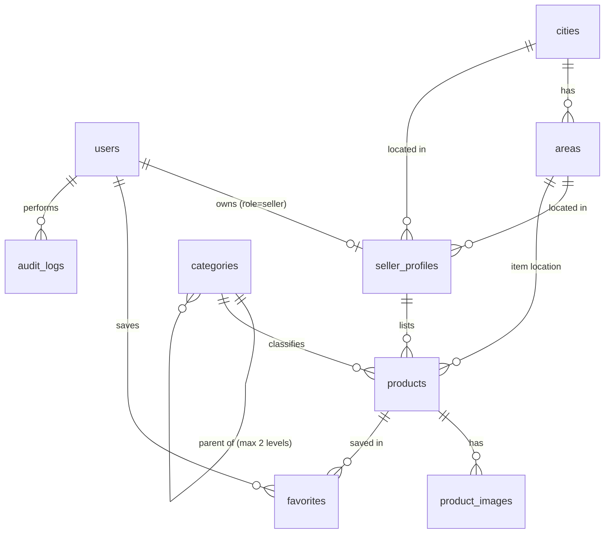
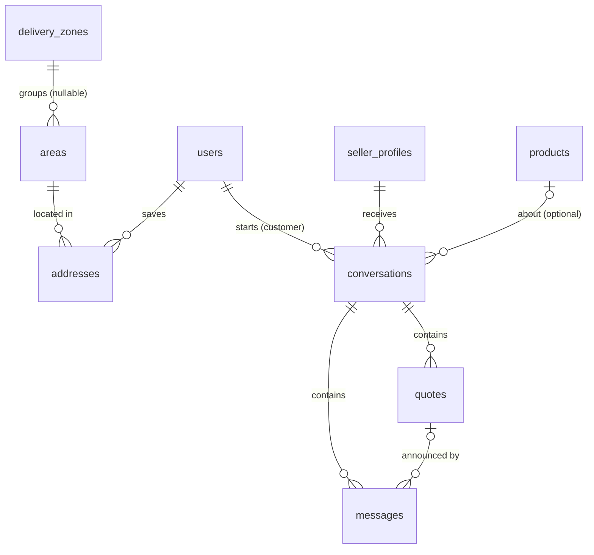
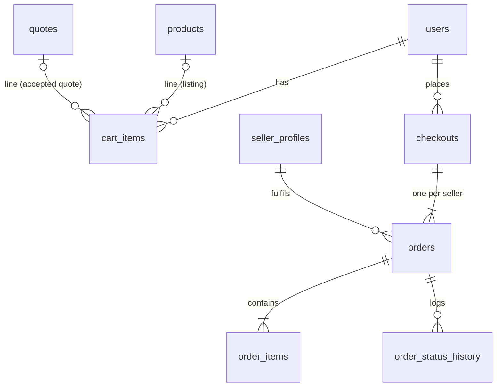

# Architecture

## Overview

```
React SPA (frontend/)  --HTTPS, Bearer token-->  Laravel API (backend/, /api/*)  -->  MySQL
                                                       |
                                                       +--> public disk (product photos)
```

- The API is the only place permissions are enforced. Frontend role checks only hide navigation.
- Authentication: Laravel Sanctum personal access tokens (30-day expiry), sent as `Authorization: Bearer`. One token per sign-in; sign-out revokes it.
- Money: every amount is stored as integer **santim** (1 ETB = 100 santim) in `*_santim` columns. The API accepts and returns birr strings (`"12500.50"`) and also returns the santim integer. No floats touch stored money.

## Roles

| Role | How it is assigned | Can |
|---|---|---|
| guest | not signed in | browse published listings, storefronts, categories |
| customer | `POST /api/auth/register` | wishlist, delivery addresses, inquiries to sellers, accept or decline quotes (orders and reviews in later milestones) |
| seller | `POST /api/auth/register-seller` creates the account and a **pending** store | drafts while pending; submit listings once approved; answer inquiries and send quotes; only ever sees own records |
| admin | `php artisan marketplace:create-admin` only | approve/reject/suspend sellers, moderate listings, manage categories and delivery zones, audit log. Admins cannot read private conversations |
| delivery | reserved for a later milestone | |

`role` and `status` are not mass-assignable, so no API payload can change them.

## Schema (milestone 1)



| Table | Key columns and constraints |
|---|---|
| users | email unique (stored lowercase), role (customer/seller/admin/delivery), status (active/suspended), bcrypt password |
| cities, areas | Addis Ababa + 11 sub-cities seeded; `areas (city_id, slug)` unique. Adding a city later is data, not code |
| seller_profiles | user_id unique FK; slug unique and stable after renames; status pending/approved/rejected/suspended; reviewed_by/at; TIN optional |
| categories | slug unique, parent_id (two levels), is_active, sort_order. Admin-managed |
| products | seller_profile_id FK, category_id FK, price_santim, condition, stock_type (in_stock/made_to_order), stock_quantity, production_days, dimensions cm, material, color, delivery fields, status, moderation_note, soft deletes. Indexes on (status, category_id), (status, price_santim), (status, published_at), (seller_profile_id, status) |
| product_images | product_id FK cascade, random file names under `products/{id}/` |
| favorites | (user_id, product_id) unique |
| audit_logs | append-only: user, action, subject, JSON meta, IP |

### Added in milestone 2



| Table | Key columns and constraints |
|---|---|
| delivery_zones | name unique, fee_santim, min_days, max_days, notes, is_active. `areas.delivery_zone_id` nullable, set null when a zone is deleted |
| addresses | user_id cascade, area_id restrict, recipient_name, phone, address_line, landmark, is_default. Max 10 per user, exactly one default while any exist |
| conversations | customer_id, seller_profile_id (restrict), product_id nullable, type (question/availability/negotiation/custom_request), status open/closed, last_message_id, customer_last_read_id, seller_last_read_id |
| messages | conversation_id cascade, sender_id, body (max 2000), quote_id nullable. Append-only, no edits |
| quotes | conversation_id, seller_profile_id, title, description, price_santim, quantity, delivery_fee_santim nullable, production_days, valid_until, status pending/accepted/declined/withdrawn |

### Added in milestone 3



| Table | Key columns and constraints |
|---|---|
| settings | key (primary), value, updated_by. Holds `commission_rate_percent` and `cod_enabled`; config values are the fallback |
| cart_items | user_id, product_id or quote_id (each unique per user), quantity. Max 30 lines, 99 per line |
| checkouts | customer_id, idempotency_key (unique per customer), payment_method, address snapshot (recipient, phone, area, line, landmark), items, delivery and grand totals |
| orders | number `ORD-000123`, checkout_id, customer_id, seller_profile_id, status, fulfillment (delivery/pickup), items_total, delivery_fee (null until the seller sets it), total, commission_rate_bp and commission_santim frozen at placement, payment_method, payment_status, paid_at, notes, cancel reason and actor, timestamps |
| order_items | order_id, product_id or quote_id, snapshot of name, unit price, quantity, line total, stock type, production days, and reserved_quantity (stock still held) |
| order_status_history | order_id, from, to, actor_id, actor_role, note, created_at. Append-only |

### Added in milestone 4

| Table | Key columns and constraints |
|---|---|
| seller_ledger_entries | seller_profile_id, type (commission/payment/adjustment), amount_santim (positive = seller owes more), order_id, method, reference, note, created_by, created_at. Append-only. Unique (order_id, type) so an order is charged once; unique (seller_profile_id, reference) so a transfer is recorded once |
| reviews | order_item_id unique, order_id, product_id, seller_profile_id, customer_id, rating 1-5, body, seller_reply, is_hidden, hidden_reason. Unique (customer_id, product_id) |
| products, seller_profiles | + rating_count, rating_sum, recomputed from visible reviews on every change |

### Added in milestone 5

| Table | Key columns and constraints |
|---|---|
| notifications | Laravel's database notifications: uuid id (time-ordered), type (the alert kind, for example `order.new`), notifiable, data {title, body, url}, read_at. Index (notifiable_type, notifiable_id, read_at) |
| sms_messages | notification_id unique (one text per alert, so a retried job never texts twice), user_id, kind, to (+251...), body (max 480), driver, status (pending/sent/logged/failed), provider_message_id, error, attempts, sent_at |
| users | + alert_sms, alert_email (both default on) |

### Added for online payments

| Table | Key columns and constraints |
|---|---|
| checkouts | + payment_due_at (online only), paid_at |
| orders | + paid_santim (what the customer paid online for this order); status `awaiting_payment` |
| payments | One attempt to pay a checkout: checkout_id, customer_id, provider, tx_ref (unique, sent to the provider), amount_santim, currency, status (pending/paid/failed/cancelled/expired), checkout_url (hidden), provider_reference, method, problem, paid_at, last_checked_at |
| refunds | order_id (unique, nullable), payment_id, customer_id, amount_santim, reason, status (due/refunded), method, reference, note, refunded_by, refunded_at |
| seller_ledger_entries | + types `sale` (negative: an online sale the marketplace holds for the store) and `payout` (positive: money sent to the store) |

Foreign keys use `restrict` where deleting the parent would destroy history (sellers, categories, cities) and `cascade` only for pure child rows (images, favorites).

## Business rules implemented

**Public visibility.** A listing is public only when it is `published`, not soft-deleted, its category is active, its seller is `approved`, and the seller's user account is `active`. Suspending a seller or deactivating a category hides their listings immediately without changing listing data, so reinstating restores them.

**Seller lifecycle.** pending -> approved | rejected; approved -> suspended -> approved (reinstate); rejected -> approved. Reject and suspend require a reason the seller sees. Transitions run under a row lock and are audited.

**Listing lifecycle.**
- Create as `draft` (any pending or approved seller) or submit straight to `pending_review` (approved sellers, at least one photo).
- Admin approves `pending_review` -> `published` (seller must be approved, listing must have a photo) or rejects with a note. Published listings can also be taken down with a note.
- Editing name, description, category, material or condition of a published listing sends it back to `pending_review` (`MARKETPLACE_REAPPROVE_ON_EDIT`). Price, stock and delivery edits go live immediately.
- `archived` hides a listing; resubmitting sends it to review. Delete is a soft delete so future order history keeps its product rows.
- Made-to-order items carry production days and no stock count; in-stock items carry a count and no production days. Every listing offers delivery, pickup, or both.

**Inquiries (Method B).**
- Only customer accounts start inquiries, about a visible listing or a visible store. Seller and admin accounts cannot.
- Allowed types follow the seller's settings: price offers only on listings marked negotiable, custom requests only where the listing or store accepts custom orders, availability and price offers only about a listing.
- A second inquiry about the same listing while a thread is open is added to that thread instead of opening a duplicate (serialised with a row lock).
- Either side can close a thread. Closed threads stay readable but take no new messages or quotes.
- When a store is suspended, both sides keep read access to history but nobody can write.
- Unread state is tracked by message id per side, not by timestamp, so two messages in the same second are never missed. Sending a message marks the thread read for the sender.
- Outsiders get 404 on every conversation and quote endpoint.
- Rate limits: 10 new inquiries per hour and 30 per day per customer; 20 messages per minute and 500 per day per user.

**Quotes.**
- Only the conversation's seller sends quotes. A new quote withdraws the seller's earlier pending quote in that thread, so the customer can only accept the latest terms.
- Validity is at most 60 days and inclusive of the last day. Expiry is derived from `valid_until` and never stored, so there is no cron job to forget.
- Accept, decline and withdraw run under row locks (conversation, then quote, the same order quote creation uses) and succeed exactly once. Verified with parallel requests against MariaDB.
- Accepting needs an open thread and an active store. Declining and withdrawing always work.
- Closing a thread ends any pending quote: declined when the customer closes, withdrawn when the seller closes.
- An accepted quote can be added to the cart and ordered at its agreed price and quantity until the later of its validity date and 7 days after acceptance (`marketplace.quotes.order_grace_days`). It can be ordered once; if that order is cancelled it can be ordered again.

**Delivery fees.**
- Admins group sub-cities into delivery zones with a default fee and day range.
- The estimate for a listing and sub-city uses the listing's own fee first (0 means free), then the zone fee, else "the seller confirms the fee before you pay". Made-to-order production days are added to the day range.
- Inactive zones are ignored. Deleting a zone leaves its sub-cities unassigned.
- `DemoSeeder` creates three demo zones with made-up fees. Real fees are a business decision set in Admin > Delivery.

**Cart and checkout (milestone 3).**
- Only customer accounts have a cart. Adding the same listing twice merges the lines; quantities are capped at the stock left. Quote lines keep the seller's quantity.
- The cart, the checkout preview and order placement share one calculator, so the numbers the customer sees are the numbers charged.
- Lines are grouped by seller and each group becomes one order. Delivery is one trip per seller, priced at the highest fee among that seller's lines (quote fee, then listing fee, then the zone fee for the address's sub-city). If any line has no known fee, the seller sets it when confirming and the customer can still cancel.
- Pickup is offered only when every line from that seller allows it.
- Placement runs in one transaction: lock the customer row, replay an existing checkout for the same `Idempotency-Key`, lock products and quotes in id order, re-price, and refuse with 409 plus fresh numbers if anything is unavailable or the total differs from `expected_total_santim`. In-stock quantities are decremented at placement and recorded as `reserved_quantity`; made-to-order items never touch stock.
- Verified against MariaDB with parallel requests: six customers racing for the last unit give exactly one order and five 409s; six parallel submits with one key give one checkout, one 201 and five 200 replays, and stock taken once.
- Rate limit: 10 checkouts per minute per user.

**Orders.**
- States: pending_confirmation -> confirmed -> processing -> ready -> dispatched -> delivered, or cancelled. Delivered and cancelled are final.
- Sellers confirm first (a suspended store cannot), entering the delivery fee if it was not known. After that they move forward and may skip steps; pickup orders never use dispatched.
- Customers cancel while pending_confirmation or confirmed. Sellers cancel up to ready. Admins only cancel, from any non-final state. A reason is required and shown to the other side.
- Cancelling returns reserved stock exactly once (the reserved quantity is zeroed in the same locked transaction).
- Delivered marks a cash-on-delivery order paid.
- Every change writes `order_status_history` and the audit log, under a row lock on the order.

**Commission.**
- Admins set the rate (0 to 50%, 2 decimals) in Admin > Settings. It is stored in basis points on each order at placement, so later changes never rewrite existing orders.
- Commission is charged on item totals, not delivery fees, rounded half up to the santim with overflow-safe integer maths.
- The admin overview reports gross sales, commission earned (delivered orders only) and open order value, labelled so that sales are never read as profit.
- On cash-on-delivery orders the seller owes the commission (decided 2026-10-11); see Seller balances and settlements.

**Seller balances and settlements (milestone 4).**
- Customers pay sellers in cash, so the platform's commission becomes a balance the seller owes. When a cash order is marked delivered, its commission is added to the seller's ledger in the same transaction. Orders delivered before the ledger existed are back-filled by the migration.
- Admins record payments (cash, bank transfer, telebirr, other). Bank and telebirr payments need a reference, stored upper-case, and the same reference cannot be recorded twice for a store. A payment cannot exceed the balance; credits go through adjustments, which need a written reason. Nothing is ever edited or deleted; mistakes are corrected with another adjustment.
- Payments and adjustments lock the store row. Verified with parallel requests: one payment per reference, and payments that together exceed the balance are refused once the balance is used up.
- Optional credit limit (Admin > Settings, 0 = off): a store owing more cannot confirm new orders until it pays. Customers can still cancel, so nobody is stuck.
- Sellers see their balance, statement and the payment instructions from Admin > Settings.

**Reviews.**
- Only the customer of a delivered order can review its items, for 60 days after delivery (`marketplace.reviews.window_days`), and can edit the review in that window. One review per customer per listing, however many times they bought it.
- Public reviews show the first name and last initial and a "verified purchase" label. Reviews of hidden listings and stores are not public.
- Sellers can post one public reply per review (editable). Admins can hide a review with a reason (audited) and restore it.
- Rating totals are recomputed from visible reviews after every change, under row locks on the listing and the store, so parallel reviews cannot leave totals short.

**Admin users and reports.**
- Admins search accounts by name, email or phone and suspend or reactivate customer and seller accounts with a reason. Suspending signs the account out everywhere; a suspended seller's listings disappear. Admin accounts are managed only from the command line.
- Reports cover a date range of up to a year in Addis Ababa time: orders placed, delivered gross sales, item value, delivery fees, commission earned, commission collected, cancellations by side, top stores and a daily table. Gross sales, commission and collections are kept separate and none is called profit.
- Orders in the range can be downloaded as CSV. Cells starting with = + - @ are prefixed so spreadsheets do not run them as formulas. Exports are audited.

**Alerts (milestone 5).**
- Every alert is an in-app alert (the bell in the header, `/notifications`), and some also go by email or SMS. Who gets what is in `app/Services/Alerts.php`. Texts are kept for things that need action soon: a new order and a cancelled order for the store, a confirmed, dispatched, ready-for-pickup or cancelled order for the customer, a new inquiry, and a store being approved, suspended or reinstated.
- Alerts are sent only after the database transaction commits, so a rolled-back checkout or status change alerts nobody. A failing mail server or SMS provider is logged and never turns the action itself into an error.
- In-app alerts are written straight away; email and SMS go through the queue, retried 3 times (after 1 and 5 minutes). Provider errors that a retry cannot fix (bad number, rejected request, missing token) are not retried.
- Users choose email and SMS on or off in Alert settings, and set their mobile number there. Suspended accounts get nothing. Admins can pause every text in Admin > Settings, and see each text and its status in Admin > Text messages.
- Texts go only to Ethiopian mobile numbers (09 and 07), stored as +2519... or +2517... A store's texts go to the store phone. A customer without a mobile number on the account gets order texts at the phone given at checkout.
- Messages already have their own unread badge, so they make no in-app alert. They email at most once per conversation and person every 30 minutes. A new inquiry also texts the store, at most once per customer and store a day. Both limits use atomic cache adds, verified with 6 parallel requests: exactly one email and one text.
- Quotes alert through the quote (sent, accepted, declined), not as a message.

**My account.**
- Every account has a My account page (`/account`) to change its name, email, phone and password, and to sign out other devices. Role and status cannot be changed there.
- Changing the email or the password needs the current password. The old email address gets a notice when the email changes, and the account gets one when the password changes. These security emails ignore the alert settings.
- A password change signs out every other device and keeps this one. Admins need 12 characters with a symbol, as when created from the command line.
- Wrong current passwords are limited to 5 per account every 15 minutes. Each attempt is counted before it is checked, so parallel guesses cannot get past the limit; a correct password resets the count. Typos in other fields are not counted.
- The customer header shows Account instead of Addresses; addresses are linked from My account and used at checkout.

**Shopping helpers and look (UI refresh).**
- Libraries: lucide-react (icons), @headlessui/react (accessible menus, dialogs, drawer, filter sheet), sonner (toasts), embla-carousel-react (photo gallery and product rails), Inter and Fraunces fonts from @fontsource (served from the app, no Google Fonts request).
- Compare: up to 4 listings side by side (price, rating, stock, size, material, color, condition, delivery, custom orders, seller, location) with the lowest price marked. The list is kept in this browser (`mp_compare`), follows other open tabs, and still works for the page view when site storage is blocked. Listings that are removed or hidden since they were picked leave the list on the compare page, with a note.
- Recently viewed: the last 12 listings this browser opened (`mp_recent`), shown on the home page and under each listing (without the one being viewed). Prices and stock are always fetched fresh.
- Quick view on product cards (tablet and desktop), similar furniture from the same category under each listing, share to Telegram, WhatsApp, the phone's share sheet or a copied link.
- Catalog: active filters shown as removable chips; on phones the filters open as a bottom sheet with a live result count.
- Phones: the listing page has a fixed buy bar; the compare pill is hidden there so it does not cover the bar.
- `GET /products?slugs=a,b,c` returns only those listings that are visible to the public (unknown or hidden ones are skipped), at most 24, for compare and recently viewed.
- Account, seller and admin pages are loaded on demand, so shoppers download less on first visit.
- Demo listings get drawn furniture pictures (`DemoFurnitureArt`). `php artisan marketplace:demo-pictures` redraws the old plain demo pictures on an existing demo database; it touches only demo images, never seller uploads.

**Online payment (Chapa).**
- One Chapa page covers telebirr, CBE Birr, M-Pesa, bank apps and cards. The customer picks "Pay now online" or "Cash on delivery" at checkout. Paying online needs every delivery fee to be known; otherwise the customer chooses pickup or cash.
- An online checkout creates its orders as `awaiting_payment` and reserves the stock at once. Stores do not see these orders and get no alert until payment goes through. The customer has 30 minutes (`MARKETPLACE_PAYMENT_WINDOW_MINUTES`) to pay; the order page shows a countdown, Pay now and Cancel.
- Nothing the browser or a callback says is trusted. The return page, the callback, the webhook and the expiry job only trigger a server-side verify with Chapa, and only Chapa's verify answer changes anything. Webhooks must carry a valid HMAC signature. The provider is never called inside a database transaction.
- A verified payment of the full amount sends every order of the checkout to its store (`pending_confirmation`, paid). Less than the total, or another currency, is not accepted and becomes a refund. More than the total is accepted and noted on the payment.
- A payment that arrives after the order was cancelled, or a second payment for a checkout already paid, becomes a refund. Checking the same payment any number of times, in parallel, changes things once (row locks on checkout, then payment, then orders; verified with 20 parallel checks on MariaDB).
- Each try is a separate payment with its own reference. A page opened in the last 15 minutes is reused. If Chapa cannot start the payment, the order stays and the customer can retry or cancel.
- Expiry (`marketplace:expire-payments`, every five minutes through the scheduler) first verifies any open payment. If Chapa cannot be reached it waits one more window before cancelling. Cancelling unpaid orders (customer, admin or expiry) cancels the whole checkout, releases the stock and, unless an admin did it, puts the items back in the customer's cart.
- Cancelling a paid order (customer, store or admin) creates a refund for what was paid. Refunds are sent by an admin in the Chapa dashboard or by transfer, then marked in Admin > Payments with the method and reference; the customer is told at both steps.
- Ledger: when a paid order is delivered the store is charged its commission (+) and credited the sale (- what was paid), so the balance goes negative: the marketplace owes the store. Admins record payouts in Admin > Settlements; a payout cannot exceed what is owed and a reference cannot be used twice. A store over its commission credit limit can still confirm orders that are already paid.
- The test gateway (`MARKETPLACE_PAYMENT_GATEWAY=fake`) shows an in-app test page where you choose the outcome. It is replaced by "not available" whenever `APP_ENV=production`.

**Ownership.** All seller endpoints look records up through the signed-in seller's own profile, so another seller's id returns 404 (no existence leak). Tests cover show, update, delete, submit, archive, image upload and image delete across sellers.

## Security measures in place

- bcrypt password hashing; minimum 8 characters with letters and numbers (12 + symbols for admins).
- Login: constant-time path for unknown emails, 5 attempts per minute per email+IP and 20 per IP. Registration 10 per hour per IP. Uploads 30 per minute per user. Catalog browsing 300 per minute per user, or per IP for guests (`MARKETPLACE_CATALOG_RATE`; set high because mobile carriers put many phones behind one IP).
- Validation on every write; LIKE search input is escaped; all queries use bindings.
- Mass assignment restricted with explicit fillable lists; strict model mode in non-production to catch silently dropped attributes and lazy loading.
- Uploads: content-checked images only (jpg, png, webp; no SVG), 5 MB, 200 to 8000 px, max 8 per listing enforced under a row lock, stored under random names.
- API 404s never reveal model names; 500s never return server messages to the UI.
- CORS limited to `CORS_ALLOWED_ORIGINS`. Bearer tokens mean CSRF does not apply to the API; there are no cookie-authenticated API routes.
- CSV exports escape formula-like cells.
- Checkout requires an `Idempotency-Key` header; prices and totals are always recomputed on the server.
- Audit log for settlement payments and adjustments, review hiding, account suspension, report exports, checkouts, every order status change, settings changes, seller applications and reviews, listing create/update/submit/archive/delete/moderation, category changes, quotes (sent, accepted, declined, withdrawn), delivery zone changes, alert setting changes, profile and password changes, signing out other devices and CLI admin creation.
- Payment provider keys come only from `.env`. Payment state changes only after a server-side verify with the provider; callbacks and the return page cannot mark anything paid. Payment endpoints are limited (checkout limit for starting payments, 120 per minute per IP for callbacks). Customers can only see and pay their own checkouts (404 otherwise).
- SMS provider credentials come only from `.env`. Logs mask phone numbers; the full number is visible only to admins in Admin > Text messages.

## Decisions and defaults (change if the business decides otherwise)

| Decision | Default chosen | Why |
|---|---|---|
| Token storage | `localStorage` | Simple and works across domains. Trade-off: an XSS bug could read the token. Moving to Sanctum cookie auth on a shared domain is the hardening step before launch |
| One role per account | seller accounts are separate from customer accounts | Simplest correct permission model; sellers can still browse and save favorites |
| Moderation on edit | content fields only | Avoids blocking sellers from updating price and stock while still catching bait-and-switch content |
| Brand name | "Betoch Furniture" via `MARKETPLACE_NAME` | Placeholder; one env change |
| Commission | 10% starting value, editable in Admin > Settings | Frozen on each order at placement |
| Payment | cash on delivery and online through Chapa, each switchable in Admin > Settings | Chapa covers telebirr, CBE Birr, M-Pesa, bank apps and cards with one integration |
| Online payment window | 30 minutes, then the order is cancelled and stock released | Long enough to pay from a phone; short enough not to hide stock |
| Refunds and payouts | recorded by an admin after sending the money | Chapa's refund and transfer APIs are not verified against a live account yet; manual is safe to start with |
| Paid online, store over its credit limit | can still confirm | The customer has paid, and delivering lowers what the store owes |
| Delivery for several items from one seller | one trip, highest line fee | Matches how sellers deliver; avoids charging per item |
| Contact seller | in-app inquiries, plus the public store phone while `MARKETPLACE_SHOW_SELLER_PHONE=true` | Keeps today's behavior. Turning it off keeps deals in the app, where commission can be earned |
| Admin access to conversations | none | Privacy by default. Needed later for disputes, with an audited read |
| New-message alerts | in-app unread badge, plus at most one email per conversation every 30 minutes | Avoids an email per chat line |
| SMS provider | AfroMessage behind a driver setting; `log` (send nothing) by default | Common Ethiopian provider with a simple HTTP API. Untested against a live account until the business opens one |
| Which alerts are texts | only alerts that need action within hours | Texts cost money per message |

## Planned design for the next milestones

Checkout, orders and stock reservation shipped in milestone 3 (see Business rules). Still planned:

**Returns and disputes.** returned and disputed states after delivery, with an audited admin read of the conversation.

**Payments, later steps.** Sending refunds and store payouts through Chapa's APIs instead of by hand, once tested against a live account. Direct telebirr or bank integrations only if Chapa's fees or coverage make it worth it.

**Also planned:** disputes and returns.

## Roadmap

| Stage | Scope | Status |
|---|---|---|
| 1 | Repository inspection | Done: repository was empty |
| 2 | Foundation: schema, auth, roles, seeders, API client, shared UI | Done |
| 3 | Catalog: home, categories, search, filters, sorting, pagination, product page, storefronts, wishlist | Done. Inquiries move to milestone 2 |
| 4 | Seller: application, approval, dashboard, listings, photos, stock | Done. Orders and finance views come with stage 5 |
| 6 (part) | Admin: seller approval, listing moderation, categories, audit log, counts | Done |
| 2 (milestone 2) | Inquiries and custom quotes, customer addresses, delivery zones | Done |
| 5 | Cart, checkout, multi-seller orders, stock reservation, cash on delivery | Done (milestone 3). Online payment added later (see the last row) |
| 6 rest | Seller and admin order handling, commission settings | Done (milestone 3) |
| 6 (milestone 4) | Commission balances and settlements, reviews, admin users, reports and CSV export | Done. Disputes are planned |
| Milestone 5 | In-app, email and SMS alerts, alert settings, admin text message log | Done. Live SMS needs an AfroMessage account |
| Online payments | Chapa checkout, payment window and expiry, refunds, store payouts, admin Payments page | Done. Live payments need a Chapa account and keys |
| 7 | CI, end-to-end tests, deployment scripts, backups automation | Planned |
